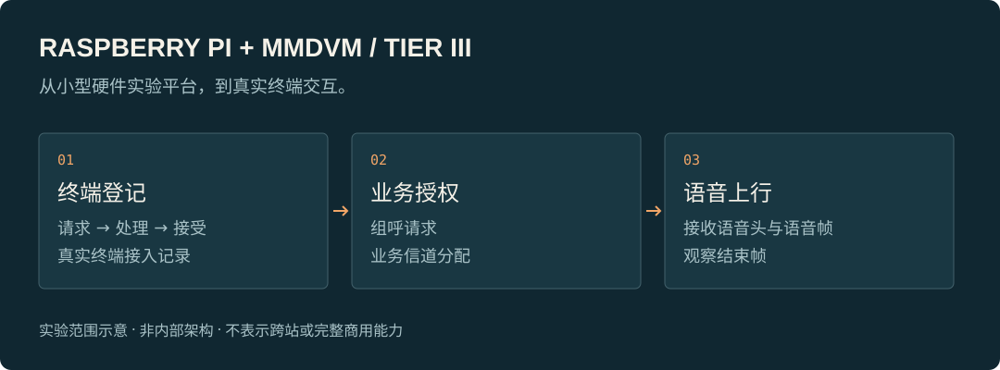

# Raspberry Pi + MMDVM Trunking Lab

[中文](README.md)

**Exploring a DMR Tier III trunking station on a Raspberry Pi with a duplex MMDVM that can interact with real handsets.**

Starting from a small hardware lab setup, this project wires together terminal registration, service authorization, and group-call flow in practice. It is an ongoing trunking-communications experiment.

## What this aims to be

Trunking needs the site to take part in terminal access and service resource allocation. This project asks: can a Raspberry Pi plus duplex MMDVM carry an experimental station that interacts with real trunking handsets?

The value is turning trunking call flow into an experiment you can build, observe, and re-verify — not stopping at software configuration or signal transmission alone.

## What I am working on

- **Adaptation between hardware and site software**: bringing an existing duplex MMDVM platform into the trunking-site experiment flow, including interoperability issues that remain after the software can start.
- **Terminal access and service flow**: following real handset behavior around registration, authorization, group call, and release — not only whether a management page shows the unit as online.
- **End-to-end troubleshooting**: lining up terminal requests, site handling, and over-the-air results to separate “request received,” “handled successfully,” and “service actually occurred.”

## A milestone already demonstrated

In a single-site lab record from August 2026, a Raspberry Pi Zero 2 W with a duplex MMDVM completed registration request, site table entry, and accept response with a real Hytera handset. Repeat records after reboot also covered this access flow.

Later records the same day further covered group-call request, traffic-channel assignment, and uplink reception of voice header, voice frames, and end frame. What is shown here is **terminal access and single-site group-call voice uplink** — not expanded to full-network voice interoperability or completion of every service.

In later joint testing, cross-site group call was also exercised with a peer using real handsets. That is a completed joint-test milestone for that session only; it does not mean current versions, all handsets, or long-running operation have been accepted.

## Current scope

This is an experimental prototype under ongoing development. Cross-site services still need separate verification per version, handset, and operating conditions; handset compatibility, long-term stability, and full RF metrics each still need their own verification. Single-site results are not treated as commercial base-station maturity.

## About this repository

This is a public project showcase page. It provides only an introduction and a capability sketch. It does not distribute source code, firmware, deployment configuration, over-the-air parameters, or raw logs. The diagram above illustrates experimental flow; it does not show internal implementation and is not a live test screenshot.

The project builds platform adaptation and trunking-interoperability experiments on open-source foundations such as MMDVM and DMRTC. It does not present the upstream protocol stack as an independent from-scratch implementation.

[Back to profile](https://github.com/Cao150702) · [Discuss this project](mailto:15048094700@163.com)
