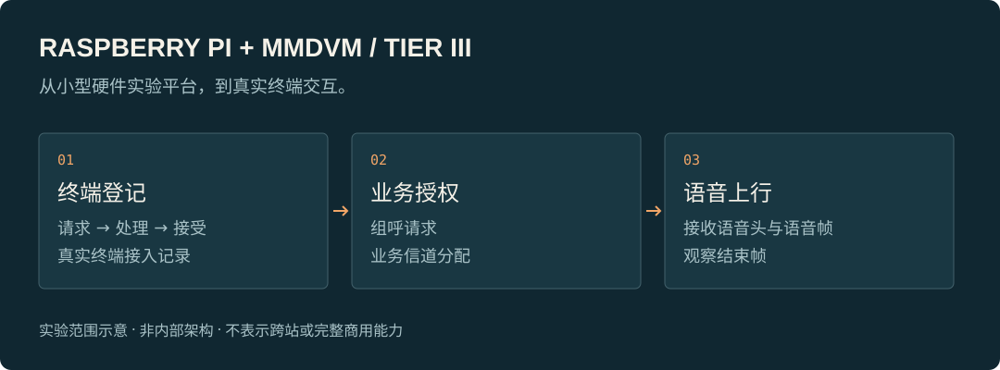

# Raspberry Pi + MMDVM Trunking Lab

[English](README.en.md)

**用树莓派和双工 MMDVM，探索可与真实终端交互的 DMR Tier III 集群站点。**

从一套小型硬件实验平台出发，把终端登记、业务授权和组呼流程实际串起来。这是我持续推进的集群通信实验项目。

## 想做成什么

集群通信需要站点参与终端接入和业务资源分配。这个项目关注的是：树莓派与双工 MMDVM 组合，能否承载一个与真实集群终端交互的实验站点？

价值在于把集群呼叫流程变成可搭建、可观察、可反复验证的实验，而不止停留在软件配置或信号发射。

## 我在推进的部分

- **硬件与站点软件之间的适配**：让现有双工 MMDVM 平台接入集群站点实验流程，处理软件能启动之后仍会遇到的互通问题。
- **终端接入与业务流程**：围绕登记、授权、组呼和释放，跟进实际终端行为，而不只看管理页面是否显示在线。
- **端到端排查**：把终端请求、站点处理和空口结果对照起来，区分收到请求、处理成功和业务实际发生。

## 一个已经跑通的里程碑

2026 年 8 月的单站实验记录中，树莓派 Zero 2 W 与双工 MMDVM 配合真实海能达终端，完成了登记请求、站点入表和接受应答。重启后的重复记录也覆盖了这一接入流程。

后续同日记录进一步覆盖组呼请求、业务信道分配，以及语音头、语音帧和结束帧的上行接收。这里明确展示的是**终端接入与单站组呼语音上行**，不把它扩大成全网语音互通或所有业务完成。

在后续联调中，曾与同伴使用真实终端跑通跨站组呼。这是已完成的联调里程碑，但仅代表该次联调结论，不代表当前各版本、全部终端或长期运行都已验收。

## 当前范围

这是持续开发的实验原型。跨站业务仍需按具体版本、终端和运行条件分别验证；不同终端兼容性、长期稳定性与完整射频指标仍需各自验证。不把单站结果等同于商用基站成熟度。

## 关于这个仓库

这是公开项目展示页，仅提供项目介绍与能力示意，不提供源码、固件、部署配置、空口参数或原始日志。上图呈现实验流程，不展示内部实现，也不充当实测截图。

项目基于 MMDVM、DMRTC 等开源工作的基础推进平台适配与集群互通实验，不将上游协议栈表述为从零独立实现。

[返回个人主页](https://github.com/Cao150702) · [交流这个项目](mailto:15048094700@163.com)
